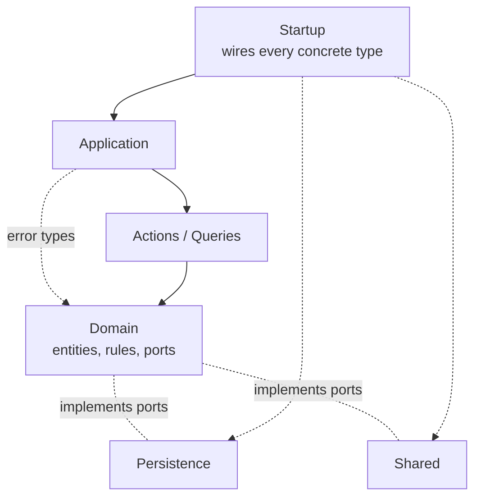
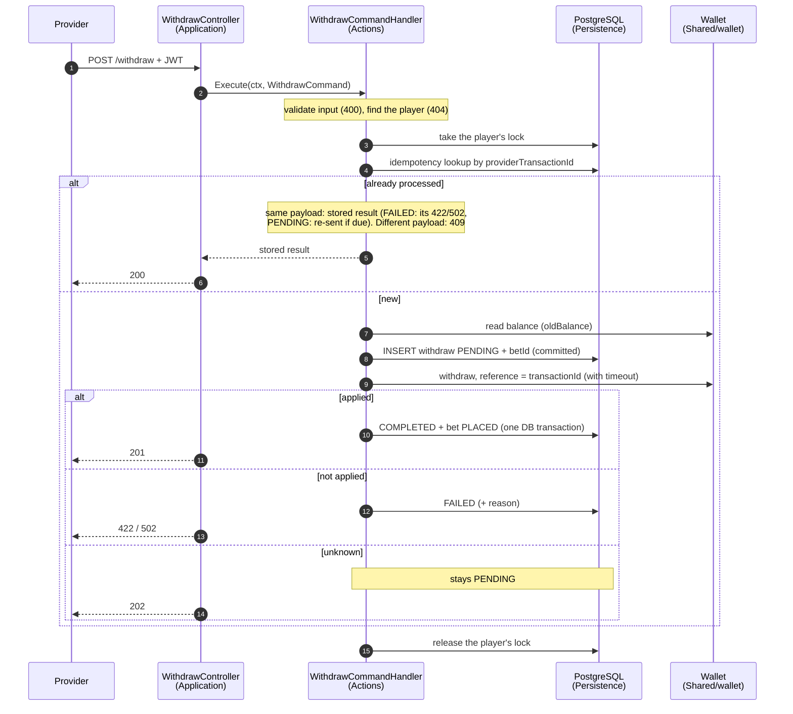

# Architecture

Clean Architecture, kept proportionate: business rules in the centre, with HTTP,
PostgreSQL and the Wallet client at the edges, reached through interfaces that
the business layer owns. How the service behaves (failures, idempotency,
cancel) is in [`DESIGN.md`](DESIGN.md); this file is about structure.

## Folder layout

The repository is a single Go module (monorepo). Folder names are PascalCase by
project convention; **Go package names inside them are lowercase**
(e.g. `Domain/` → `package domain`).

```
Startup/       composition root: config, wiring, router, server, resolver
Application/   HTTP: controllers, DTOs, auth middleware, error → HTTP
Actions/       state-changing use cases (Withdraw, Deposit, Cancel, …)
Queries/       read-only use cases (GetPlayer)
Domain/        entities, money, rules, errors, ports; domaintest/ fakes
Persistence/   PostgreSQL adapters, per-player lock, migrations, seed
Shared/        Wallet client, JWT, bcrypt, clock, IDs
docs/          design details, try-it, OpenAPI spec, Wallet findings, plans
```

## Dependency rule

An arrow means "imports". Every arrow points towards `Domain`; nothing in
`Domain` points out.



- `Domain` imports **nothing** from this repository (only stdlib + `decimal`).
- `Actions` and `Queries` import only `Domain`.
- `Application` imports `Actions`, `Queries` and `Domain` (for error types/DTO mapping).
  It never imports `Persistence` or `Shared`.
- `Persistence` and `Shared` implement `Domain` ports; they never import
  `Actions`, `Queries` or `Application`.
- `Startup` is the only package that knows every concrete type.

For a .NET developer: `Domain` ≈ the core/domain project, `Actions`/`Queries` ≈
MediatR command/query handlers, `Application` ≈ controllers, `Persistence` ≈
the EF/Dapper infrastructure project, `Startup` ≈ `Program.cs`. Go has no DI
container: wiring is plain constructor calls in `Startup` (`newHandlers` in
`Startup/main.go`).

## Endpoints

Every protected route is wrapped in `application.RequireAuth`, which takes the
player only from the verified JWT.

| Route | Controller (`Application`) | Use case | Per-player lock |
|---|---|---|---|
| `GET /health` | `Health` | — | no |
| `POST /api/v1/auth/login` | `LoginController` | `actions.LoginCommandHandler` | no |
| `GET /api/v1/player` | `PlayerController` | `queries.GetPlayerQueryHandler` | no (read only) |
| `POST /api/v1/withdraw` | `WithdrawController` | `actions.WithdrawCommandHandler` | yes |
| `POST /api/v1/deposit` | `DepositController` | `actions.DepositCommandHandler` | yes |
| `POST /api/v1/cancel` | `CancelController` | `actions.CancelCommandHandler` | yes |
| *(background, no route)* | — | `actions.ResolvePendingCommandHandler`, run by `Startup/resolver.go` | yes, per transaction |

## Request flow (withdraw)

Deposit and cancel follow the same path; only the business checks and what
happens to the bet differ.



`Application` maps the result to the status code and the §7.4 body, and every
domain error to its HTTP code (`writeDomainError`, with `errors.Is`).

## Domain model

| Type | Purpose | Rules enforced in `Domain` |
|---|---|---|
| `Money` | Exact amount (`shopspring/decimal`, unexported field) | ≥ 0, ≤ 2 decimals, ≤ 18 integer digits; JSON number in and out, never `float64`; `Add`/`Sub` re-check the result |
| `Currency` | `USD`, `EUR`, `KES` | exact uppercase codes only |
| `UserID`, `BetID`, `TransactionID`, `ProviderTransactionID` | Named ID types | the compiler refuses to mix them; provider ID non-empty, ≤ 128 characters |
| `Bet` | A wager, created when its withdraw completes | `PLACED → WON/LOST` (`Settle`), `PLACED → CANCELLED` (`Cancel`), `WON/LOST → PLACED` (`RevertSettlement`) |
| `Transaction` | One money movement (`WITHDRAW`, `DEPOSIT`, `CANCEL`) | born `PENDING`; `→ COMPLETED` / `→ FAILED` (with a `FailureReason`); `COMPLETED → CANCELLED` (not for `CANCEL`); withdraw amount > 0 |
| `DecideCancel` | The §8.5 table as a pure function | returns credit back / debit back / no Wallet call, or the domain error |

Every refused transition returns an error and changes nothing. Domain errors
wrap one of seven categories (one per API error code), which `Application`
maps to HTTP.

## Ports and adapters

Each port is an interface declared in `Domain` (where it is consumed), with one
production adapter and one in-memory fake for the use-case tests.

| Port (`Domain`) | Production adapter | Test fake (`Domain/domaintest`) |
|---|---|---|
| `PlayerRepository` | `persistence.PlayerRepository` | `FakePlayerRepository` |
| `PlayerLocker` | `persistence.PlayerLocker` (PostgreSQL session advisory lock) | `FakeStore` |
| `UnitOfWork` (+ `BetRepository`, `TransactionRepository`) | one DB transaction on the locked connection | `FakeStore` |
| `PendingTransactionFinder` | `persistence.PendingTransactionFinder` | `FakeStore` |
| `WalletClient` | `wallet.Client` (`Shared/wallet`, HTTP with timeouts) | `FakeWallet` (success, insufficient funds, errors before/after applying, timeout, slow) |
| `PasswordHasher` | `password.Bcrypt` | `FakePasswordHasher` |
| `TokenIssuer`, `TokenVerifier` | `token.JWT` (HS256) | `FakeTokens` |
| `Clock` | `clock.System` | `FixedClock` |
| `IDGenerator` | `id.UUID` | `FakeIDGenerator` |

How the persistence ports fit together:

```
PlayerLocker.WithPlayerLock(ctx, userID, func(ctx, uow UnitOfWork) error)
   └─ UnitOfWork.Atomic(ctx, func(ctx, repos Repositories) error)   // one DB transaction
         └─ Repositories{Transactions, Bets}
```

- **Lock:** held on one pooled connection, and every query of the operation
  runs on that same connection. It outlives the commit of the `PENDING`
  transaction, so the player stays locked across the Wallet call. PostgreSQL
  releases it if the process dies.
- **Reads are scoped by player:** every `Find…`/`Update` filters by
  `wallet_user_id`, so another player's bet or transaction is "not found".
  The one exception is `PendingTransactionFinder`: the resolver's scan across
  players, never called with a player's input.
- **Money** is written as text and read as `amount::text`, then parsed by
  `domain.ParseMoney`: exact both ways, and re-validated on every read.

## Data model

Migrations live in `Persistence/migrations/` (embedded in the binary, applied by
goose at startup), `00001` to `00006`. A migration that has been applied is
never edited; changes go in a new file.

| Table | Columns | Constraints |
|---|---|---|
| `players` | `wallet_user_id BIGINT PK`, `username`, `password_hash` (bcrypt), `currency`, `created_at` | `UNIQUE(username)`, currency check |
| `bets` | `id BIGINT PK` (the `betId` sent to the Wallet, from sequence `bet_id_seq`), `wallet_user_id → players`, `currency`, `stake NUMERIC(20,2)`, `status`, timestamps | status/currency checks, `stake > 0` |
| `transactions` | `id UUID PK`, `type`, `status`, `wallet_user_id → players`, `bet_id` (no FK: a `PENDING` withdraw's bet does not exist yet), `provider_transaction_id`, `cancelled_transaction_id → transactions` (`CANCEL` only), `amount`, `currency`, `old_balance`, `new_balance` (NULL until completed), `failure_reason` (`FAILED` only), timestamps | type/status/currency checks, `amount >= 0`, withdraw `amount > 0`, `cancelled_transaction_id` present iff `CANCEL` |

The unique indexes carry business rules, so they hold even if Go code is wrong
or two instances race:

| Index (partial, on `transactions`) | Rule | Domain error on violation |
|---|---|---|
| `transactions_idempotency_key` `(provider_transaction_id)` where `WITHDRAW`/`DEPOSIT` | One transaction per provider ID across the whole system (§6.1, §7.1) | `ErrTransactionExists` |
| `transactions_active_settlement` `(bet_id)` where `DEPOSIT` and `PENDING`/`COMPLETED` | One active settlement per bet (§8.4) | `ErrBetAlreadySettled` |
| `transactions_single_cancel` `(cancelled_transaction_id)` where `CANCEL` | One cancel per transaction (§8.5) | `ErrAlreadyCancelled` |

A fourth partial index, `transactions_pending`, only speeds up the resolver's
scan of `PENDING` rows.

## Shared code of the money operations

The three operation handlers embed one `operation` struct (`Actions/operation.go`)
with the common dependencies and steps: run under the player's lock
(`runLocked`), read `oldBalance`, store `FAILED`, leave `PENDING`, log (with a
typed `logOutcome`, `Actions/log_outcome.go`). `classifyWalletResult`
(`Actions/wallet_outcome.go`) holds the applied / not applied / unknown rule
once. Embedding is composition, not inheritance: `operation` knows nothing
about the handler that contains it.

Each handler's `Execute` validates its command into an unexported request
(`withdrawRequest`, `depositRequest`, `cancelRequest`) that the rest of the
handler receives. Its locked step starts with `replayOrResend`: a known
provider ID gets its stored result, or a re-send if it is `PENDING`; only a
new one goes on to a new transaction.

**Pending resolution** reuses the same path: a provider retry and the
background resolver both call the handler's `resendPending`, which re-sends the
identical Wallet request and ends in the same `finish` step as a first attempt.

## Naming convention

| Layer | Name | Example |
|---|---|---|
| `Application` | `XxxController`, one per endpoint, implements `http.Handler` | `LoginController` |
| `Actions` | `XxxCommandHandler` + `XxxCommand` / `XxxResult` | `LoginCommandHandler` |
| `Queries` | `XxxQueryHandler` + `XxxQuery` / `XxxResult` | `GetPlayerQueryHandler` + `GetPlayerQuery` / `PlayerResult` |

"Handler" is reserved for use cases (the MediatR analogy) and "Controller" for
HTTP, so the two layers never share a name.
