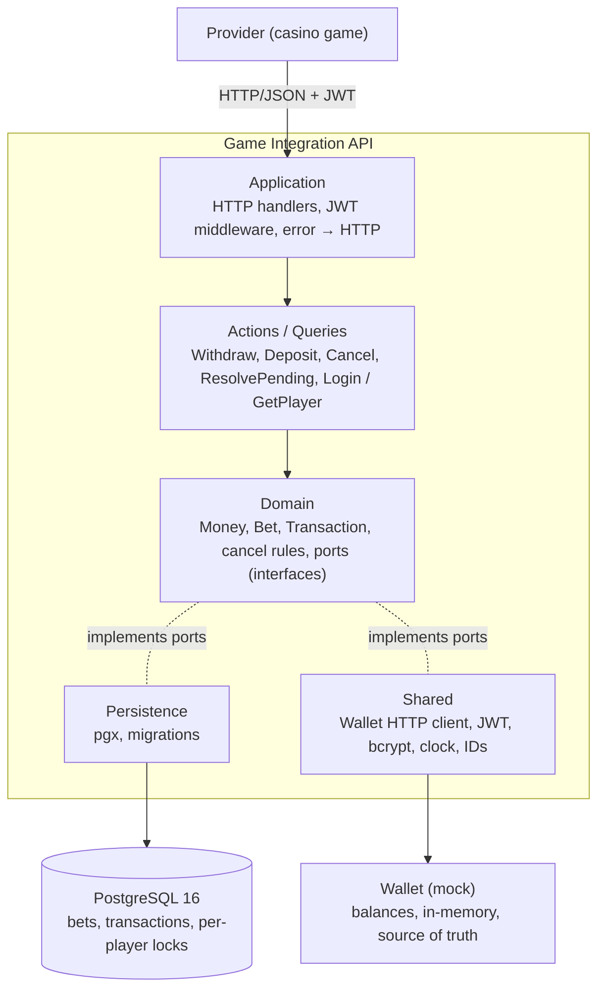

# Design decisions

> **Disclaimer:** I developed this API with the assistance of Claude Opus 5.5
> (Anthropic) as a coding assistant, as §2 of the assessment allows. I
> reviewed every change, and the decisions below are mine; I am responsible
> for all of them.

Before writing any code I ran a spike against the mock Wallet to discover
how it actually fails (errors, timeouts, duplicates, dropped connections).
The Wallet behaviour quoted below comes from it; the probes and results are
in [`docs/wallet-findings.md`](docs/wallet-findings.md). Full reasoning and
measurements: [`docs/decisions.md`](docs/decisions.md) (same section
numbers).

## Architecture

The business rules (`Domain`, `Actions`, `Queries`) do not import HTTP,
PostgreSQL or the Wallet client; they use interfaces declared in `Domain`,
implemented by `Persistence` and `Shared` and wired in `Startup`. Details in
[`ARCHITECTURE.md`](ARCHITECTURE.md).

**Every money operation follows the same path.** Under a per-player lock:
idempotency lookup → balance read (`oldBalance`) → the transaction is
committed as `PENDING` with its `betId` and the API's transaction ID as the
Wallet's `reference` → Wallet call → its outcome is classified as *applied*
(`COMPLETED`), *not applied* (`FAILED`) or *unknown* (stays `PENDING`, `202`).

## 1. Behaviour under NORMAL operation

**If a player logs in:**
- Valid username and password → return `200` with an HS256 JWT whose
  subject is the wallet user ID, and its expiry.
- Unknown username or wrong password → return the same `401`.

*Why:* the assessment asks for the same error in both cases, so the answer
never reveals which usernames exist (a dummy bcrypt check keeps the timing
equal too).

**If a player asks for their balance (`GET /player`):**
- The player comes from the token → the balance is read from the Wallet →
  return `200` with `userId`, `balance` and `currency`.

*Why:* the Wallet is the source of truth for balances; a cached value could
be stale, so it is never cached.

**If the Wallet applies a withdraw (bet placement):**
- The transaction becomes `COMPLETED` and the bet `PLACED` in one database
  transaction → return `201` with `oldBalance` and `newBalance`.

**If the Wallet applies a deposit (bet settlement):**
- Amount greater than zero → `COMPLETED`, bet `WON` → return `201`.
- Amount zero → `COMPLETED`, bet `LOST`, without calling the Wallet (see
  section 5) → return `201` with `newBalance = oldBalance`.

**If the Wallet applies a cancel:**
- Of a withdraw whose bet is `PLACED` → the amount is credited back with a
  Wallet deposit; the original becomes `CANCELLED` and the bet `CANCELLED`
  → return `201`.
- Of a deposit → the amount is debited back with a Wallet withdraw; the
  original becomes `CANCELLED` and the bet returns to `PLACED` → return
  `201`.

*Why:* the Wallet has no rollback, so a cancel is a compensating operation
on the same `betId`. The transaction and its bet always change in one
database transaction, so they never disagree.

**If a request breaks a business rule:**
- Invalid body, amount or currency → return `400`.
- The referenced transaction does not exist or belongs to another player →
  return `404`.
- Not allowed in the current state (e.g. the bet is already settled) →
  return `409`.
- In all three cases the Wallet is not called and nothing is stored.

*Why:* the Wallet validates very little and has no notion of a bet, so every
rule is checked by the API before any money moves.

**If a completed request is sent again:**
- Same provider transaction ID and same payload → return `200` with the
  stored result in its current state, without calling the Wallet.

*Why:* providers retry requests, and a replay must have no new effect.

## 2. Behaviour under FAILURE

**If the Wallet returns an error before applying the operation:**
- `400 InsufficientBalance` → `FAILED`, return `422 INSUFFICIENT_FUNDS`.
- Any other `400`, or a `401` (definitely rejected) → `FAILED`, return
  `502 WALLET_ERROR`, logged as an error (a bug or a wrong API key).
- Anything the client does not recognise → *unknown*, handled as the next case.
- A failed withdraw creates no bet; a failed deposit or cancel changes
  nothing else.

*Why:* a wrong `FAILED` cannot be undone, a `PENDING` can be resolved.
Insufficient funds and validation errors are both `400`; only the body
`code` tells them apart.

**If the Wallet returns an error after applying it:**
- `500`, or a response that never arrives → `PENDING`, return `202` with
  `newBalance: null` (and `betStatus: null` for a withdraw: its bet is not
  placed yet).
- It is resolved later by re-sending the same request (see section 3).

*Why:* in the spike every Wallet `500` had been applied (36 of 36), and
dropped connections sometimes too.

**If the Wallet times out:**
- Withdraw / deposit / cancel call: no answer within
  `WALLET_OPERATION_TIMEOUT` (6 s) → `PENDING`, return `202`. The client
  never re-sends an operation by itself.
- Balance read: 10 s per attempt, retried once, then:
  - `GET /player` → return `504 WALLET_TIMEOUT` (or `502` on an error).
  - Balance read before a withdraw / deposit → return `502`; nothing was
    sent or stored.

*Why:* the mock never answers a POST after ~5 s, but a balance read can
take ~15 s. A read is safe to repeat; an operation re-sent at once
could race the original.

**If the API process stops between the Wallet call and the database write:**
- The `PENDING` row was committed before the call → it is not lost.
- PostgreSQL releases the player's lock when the connection drops.
- On startup the background resolver re-sends whatever was left `PENDING`
  (see section 3).

*Why:* No Wallet calls may be lost: the record of what is sent must 
exist before it is sent.

**If a provider retries, or sends the same request concurrently:**
- Requests of one player wait for the per-player lock; the idempotency
  lookup runs inside it, before any Wallet call.
- Same key and same payload → return the stored result (`200`).
- Same key, different payload → return `409 CONFLICT`.
- Two requests racing past the lock (e.g. two instances) → a unique index
  (provider ID; one active deposit per bet; one cancel per transaction)
  rejects the second insert, which then reads the first one's result.

*Why:* a check in Go alone has a race window; a unique index does not.
Tested: 10 simultaneous identical requests → one Wallet call.

**If the Wallet restarts and loses its state:**
- Not detected: the restarted Wallet forgets which references it applied,
  so re-sending a `PENDING` transaction applies it again against the reset
  balances. Accepted risk.

*Why:* the Wallet is in-memory and has no transaction lookup. It
only restarts on purpose here, and the documented reset
(`docker compose down -v`) also wipes the API's database.

## 3. How a PENDING transaction gets resolved

**When a re-send is triggered:**
- The provider retries the same request → it is re-sent, and the retry
  answers the final result instead of `202`.
- The background resolver runs (at startup and every
  `PENDING_RESOLVER_INTERVAL`, 10 s) → every `PENDING` transaction is re-sent.
- The last attempt started less than 10 s ago → not re-sent yet; a retry
  answers `202`.

*Why:* a retry alone would leave silent providers `PENDING` forever; the
resolver alone would make a retry wait for an answer it can get now. The
10 s wait is because the Wallet finishes slow requests at ~5.7 s and the
client's timeout is 6 s: a re-send while the first attempt still runs could
be applied twice. Both triggers take the player's lock, so a transaction is
never re-sent twice at once.

**If the identical Wallet request is re-sent:**
- `409 DuplicatedTransaction` → it had been applied → `COMPLETED`.
- `2xx` → it had not been applied, and is applied now → `COMPLETED`.
- A definitive rejection → `FAILED` (with its reason, see section 4).
- Anything else → still `PENDING`; tried again on the next trigger.
- Still unknown 5 minutes after it was created → logged at `error` level
  (`pending_overdue`) on every attempt. There is no cap on re-sends.

*Why:* everything needed (amount, `betId`, `reference`) was stored before
the first call, and the Wallet de-duplicates by `reference`, so a re-send is
never applied twice and its answer settles the outcome. It goes through the
same code as a first attempt. Measured: the `202`s I observed were resolved
within ~20 s.

## 4. Retry of a request whose previous attempt ended FAILED

**If a provider retries a request whose previous attempt ended `FAILED`:**
- It failed for insufficient funds → return `422 INSUFFICIENT_FUNDS` again.
- It was rejected for any other reason → return `502 WALLET_ERROR` again.
- In both cases the Wallet is not called, and nothing changes.
- To try again, the provider sends a new request with a new provider
  transaction ID; the old one stays used.

*Why:* Keeping idempotency. A `FAILED` transaction stores its reason, so the first answer
can be repeated. Allowing a new attempt with the same ID was rejected: a
withdraw retried later could succeed against a game state that has moved on.

## 5. Zero-amount deposits

**If a deposit has amount zero (a lost bet):**
- It is not forwarded to the Wallet.
- The balance is still read under the player's lock → `oldBalance`.
- The deposit is stored `COMPLETED` with `newBalance = oldBalance` and the
  bet `LOST`, in one database transaction → return `201`. There is no
  `PENDING` step: there is no Wallet call to keep track of.
- The balance read fails → return `502`; nothing is stored, so the provider
  can retry.
- Cancelling it later moves no money either: the bet returns to `PLACED`
  without a Wallet call.

*Why:* no money moves, so a Wallet call could only add risk: like any call
it could fail or time out and leave a lost bet `PENDING` for nothing. The
balance is still read because `oldBalance` must be a balance the API
observed.

## 6. Other assumptions, decisions and future improvements

- **Money:** a `decimal` type, never `float64`; JSON numbers only, decoded
  exactly; more than 2 decimals is rejected, never rounded; `NUMERIC(20,2)`.
  Currencies must match exactly and match the player's account.
- **`oldBalance`** is read from the Wallet under the player's lock. If the
  Wallet applied an operation but did not report the balance, `newBalance`
  is `oldBalance ± amount`.
- **Replays return the current state:** a withdraw cancelled since its first
  answer replays with `status: CANCELLED`.
- **Ownership:** another player's transaction is `404`. Provider IDs are
  unique across the system, so reusing another player's ID is a `409` that
  only says the ID is taken.
- **Cancel** is a compensating Wallet operation on the same `betId`. Not
  allowed (`409`) while the bet has a deposit in progress, nor a deposit
  while its withdraw has a cancel in progress. A cancel before its withdraw
  is `404`.
- **Bet rules are enforced by the API:** the Wallet has no notion of a bet and validates
  little; all validation happens before calling it.
- **Security:** the same `401` for unknown user and wrong password (with a
  dummy bcrypt check so timing does not tell them apart); strict HS256 JWT;
  logs never contain tokens, passwords, keys, headers or bodies.
- **`500 INTERNAL_ERROR`**, not in the assessment, for unexpected failures
  (e.g. database down); details only in the logs.

**With more time I would:** handle a cancel that arrives before its
withdraw (store it so the late withdraw is refused or reverted); replace the
resolver's scan with a PostgreSQL job queue (per-transaction backoff,
several instances); add metrics and alerts on `PENDING` age instead of log
lines; add a readiness check that includes the database; add refresh tokens,
revocation and login rate limiting.
